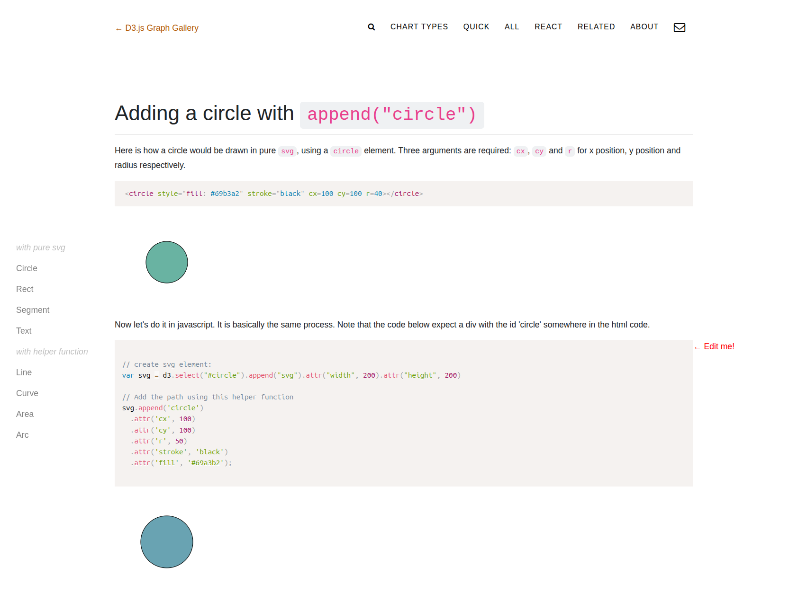
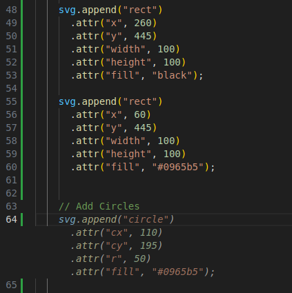

Assignment 1 - Hello World: GitHub and d3  
===
## Site Link
https://logankippnick.github.io/a1-ghd3/

## Background
When I first saw that this assignment was basically just shapes and colors, my mind immediately went to the Bauhaus movement, which I have studied a decent amount and gained an appreciation for through my German classes and my IQP in Berlin. Bauhaus was a school for designers in Weimar, Germany that then flourished as a progressive school of thought between the two World Wars. It focused on simplicity, eliminating excess ornamentation to help make a new, higher standard of living more accesible. I knew I'd be able to find a poster from a Bauhuas exibition that I could use to satisfy the requirements of this assignment, and the one I found was perfect. The image below is the poster I designed using d3.

## Process and Sources
I started with the index.html file given in the repository I forked. I then referenced [this website](https://www.dashingd3js.com/d3-tutorial/adding-an-svg-element-using-d3-js) to figure out what "Add an SVG" meant exactly, and went from there. At first I referenced [this website](https://d3-graph-gallery.com/graph/shape.html) to figure out how to add a shape.

Then, the Copilot autofill in VS Code started picking up on what I was doing and basically showed me how to do rectangles, lines, and the yellow polygon.

_I took this screenshot after the fact, deleting the circles so the autofill could suggest them back, so this suggestion was exactly what one of the circles was. Initially, it was just with more "example" values, per se._

I chose to add text, but I figured I'd still show that I learned how to use lines, so I turned the smaller text into horizontal lines. For the actual text, a quick Google search helped me come across the exact font used on the poster. A Gemini Google search response then showed me how to implement this custom font in d3.

I then chose to add some sort of interaction. I chose to make the circles grow on hover because I only have to change the radius to do this. Another Gemini Google search response revealed how to do this to me.

## Technical Achievements
I refreshed myself on how to edit HTML pages, and I learned how to use d3 to add shapes, lines, and text with different colors to one. I then iterated on the existing design by adding a hover animation to some of the shapes. Understanding the basics of d3 will prove very useful for further design work in this course.

## Design Achievements
I replicated and expanded slighlty on an existing design to gain an understanding and appreciation for it. Each color on the poster is very distinct from every other color, which makes each shape very easy to distinguish. I also learned that our eyes are very sensitive to aligmnent. One pixel made more of a difference than I previously would have thought.